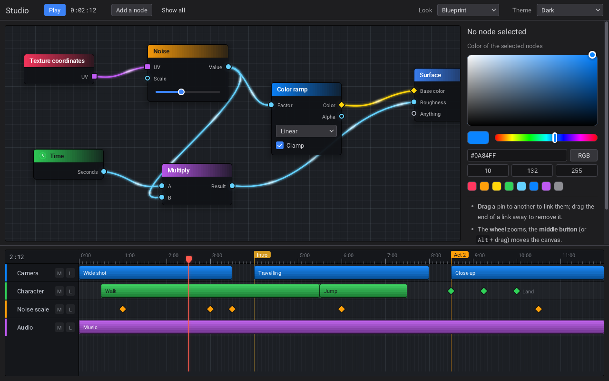
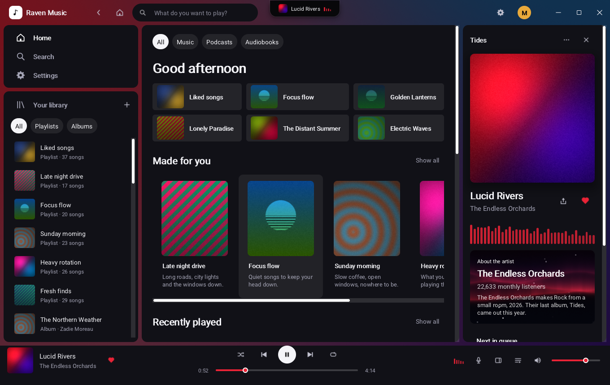
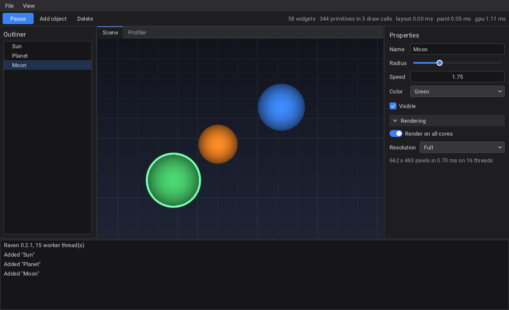
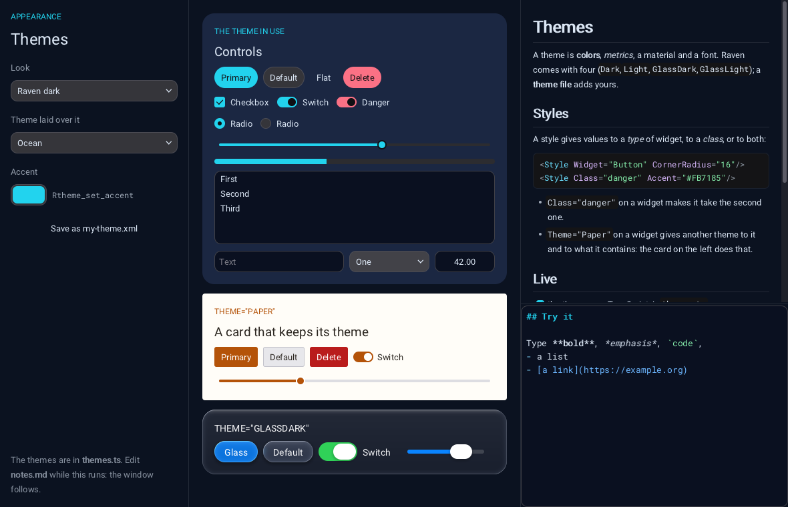
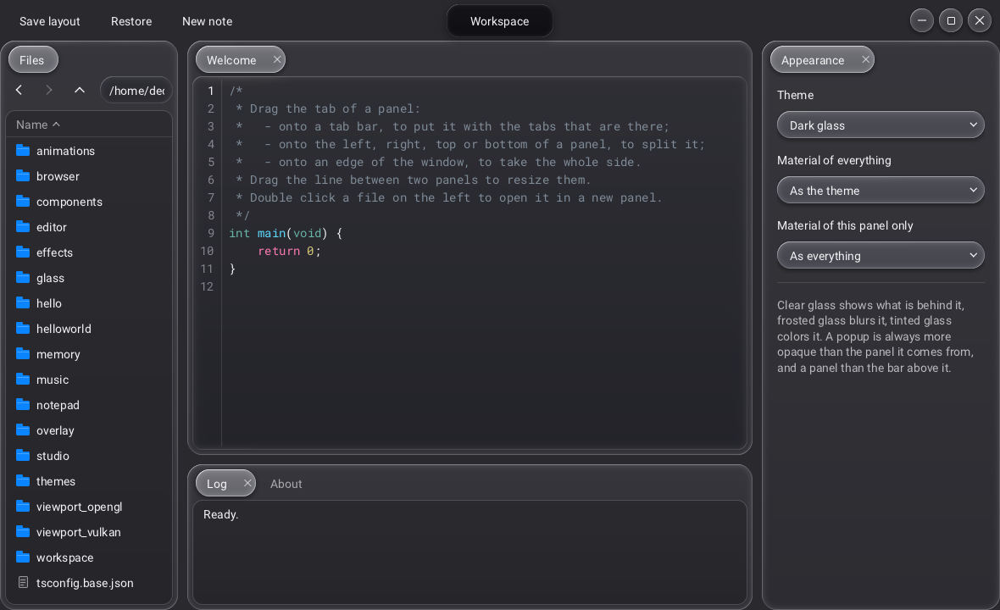
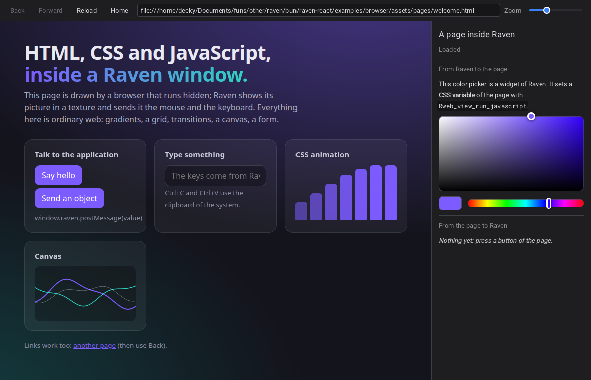
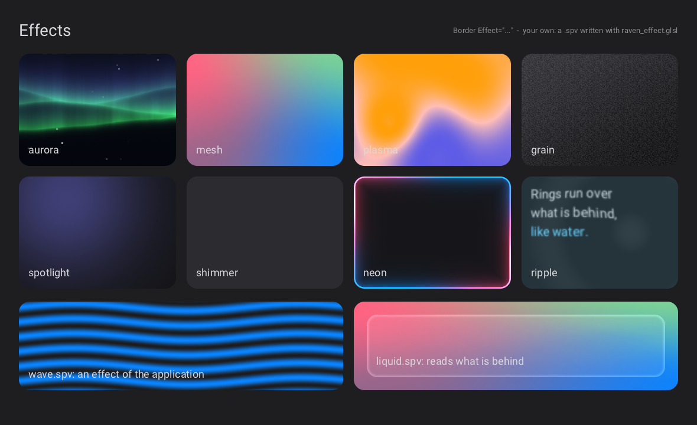
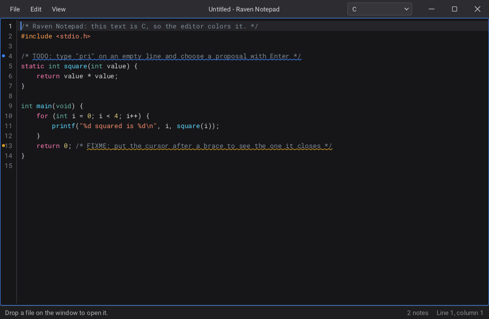

# raven-tsx

Native desktop interfaces in TSX, for [Bun](https://bun.com), on the real widgets of [Raven](https://github.com/oscar-soirey/Raven), drawn with Vulkan. A core knows only Raven, and an adapter for a framework is built on it; React is the one there is today. No XML, no webview, and no build step.

```tsx
import { useState } from "react";
import { Button, Label, runApp, VBox } from "@decky.fx/raven-tsx/react";

function App() {
	const [count, setCount] = useState(0);
	return (
		<VBox Spacing={12} Slot={{ Padding: 24 }}>
			<Label>Clicked {count} times</Label>
			<Button Style="Primary" OnClicked={() => setCount(count + 1)}>Click me</Button>
		</VBox>
	);
}

await runApp(<App />, { Title: "Hello", Width: 480, Height: 240 });
```

The package and its documentation are in [packages/raven-tsx](packages/raven-tsx).

## Examples

The C examples of Raven are ported to TSX in [examples](examples), with the same windows and the same behaviour (`viewport_vulkan` in part: JavaScript has no reasonable way to record Vulkan commands). They are the best place to see how a piece of Raven is written in React.

| | |
|---|---|
|  |  |
| **studio**: a node graph and a timeline, here in the Blueprint look | **music**: a music player with no sound, Raven's largest showcase |
|  |  |
| **editor**: a scene editor, its viewport rendered on every core | **themes**: looks, themes written in TypeScript, styles and Markdown |
|  |  |
| **workspace**: panels that dock, a file browser, the kinds of glass | **browser**: a web page inside the interface, talking to the application |
|  |  |
| **effects**: Raven's shader effects, and two of the application | **notepad**: a text editor with a custom header bar |

| Example | What it shows |
|---|---|
| [hello](examples/hello) | A window, a label and two buttons |
| [helloworld](examples/helloworld) | An application that tries everything, and compiles to one executable |
| [animations](examples/animations) | Transitions, springs in a custom widget, cards that pop |
| [components](examples/components) | Tags of your own as React components, which Raven also builds from a document made by code ([screenshot](docs/screenshots/components.png)) |
| [memory](examples/memory) | Where the memory of the library comes from, and how to watch it |
| [glass](examples/glass) | The glass themes and materials |
| [overlay](examples/overlay) | A window that is seen through, and the ways to blur what is behind |
| [viewport_opengl](examples/viewport_opengl) | An OpenGL scene in the native child window of a viewport. X11 only (GLX): on a Wayland session, start it with `RAVEN_WINDOW_SYSTEM=x11`; on Windows and macOS it says it cannot make a context |
| [viewport_vulkan](examples/viewport_vulkan) | The scene of the original, rendered in software in TypeScript |
| [browser](examples/browser), [editor](examples/editor), [effects](examples/effects), [music](examples/music), [notepad](examples/notepad), [studio](examples/studio), [themes](examples/themes), [workspace](examples/workspace) | Shown above |

To run one, check out and build Raven at the pinned commit, and make the native package first (see [Working on this package](packages/raven-tsx#working-on-this-package)), then, from the root of this repository:

    cd examples/studio
    bun run dev

## Raven

raven-tsx follows a pinned commit of Raven, written in [packages/raven-tsx/RAVEN_VERSION](packages/raven-tsx/RAVEN_VERSION). The components and their props are generated from that commit's schema, so they are always the ones the library has.
