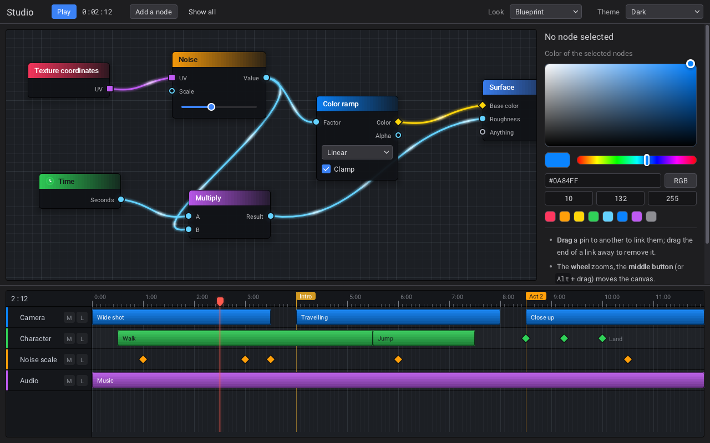

# raven-react

A React renderer for [Raven](https://github.com/oscar-soirey/Raven), for [Bun](https://bun.com): write native desktop interfaces in TSX, on Raven's real widgets. No XML and no build step, as Bun compiles TSX itself.

```tsx
import { useState } from "react";
import { Button, Label, runApp, VBox } from "@decky.fx/raven-react";

function App() {
	const [count, setCount] = useState(0);
	return (
		<VBox Spacing={12} Slot={{ Padding: 24 }}>
			<Label>Clicked {count} times</Label>
			<Button Style="Primary" OnClicked={() => setCount(count + 1)}>Click me</Button>
		</VBox>
	);
}

await runApp(<App />, { Title: "Hello", Width: 480, Height: 240 });
```



Every C example of Raven has a TSX port in [examples](../../examples), with screenshots in the [README of the repository](../../README.md).

## Install

Not on npm yet, and the name of the package is not final. Once it is published:

    bun add @decky.fx/raven-react react

```json
{ "compilerOptions": { "jsx": "react-jsx", "types": ["bun", "react"] } }
```

Raven's native library comes with it: there is a package per platform, and the package manager installs the one that fits. No install script runs, and nothing is compiled on your machine.

| Platform | Package |
|---|---|
| Linux x64, arm64 | `@decky.fx/raven-react-linux-x64`, `-linux-arm64` |
| macOS Apple Silicon, Intel | `@decky.fx/raven-react-darwin-arm64`, `-darwin-x64` |
| Windows x64 | `@decky.fx/raven-react-win32-x64` |

What the system must have: a Vulkan driver, and on Linux libX11. On macOS, version 14 or newer, Vulkan comes from MoltenVK: `brew install molten-vk`.

`RAVEN_LIBRARY` set to the path of a library has priority, to try a build of your own.

## One executable

`bun build --compile` holds Bun, your code and the native library in one file:

    bun build --compile src/index.tsx --outfile app

For another platform, install its package first:

    bun install --os=win32 --cpu=x64
    bun build --compile --target=bun-windows-x64 src/index.tsx --outfile app.exe

## How props work

The components, with their props, are generated from Raven's own schema.

| XML | TSX |
|---|---|
| `Text="Hi"` | `Text="Hi"`, or `<Label>Hi</Label>` |
| `Width="120"` | `Width={120}` |
| `Slot.Padding="24"` | `Slot={{ Padding: 24 }}`, since JSX has no dots in names |
| `Items="a\|b"` | `Items={["a", "b"]}` |
| `OnClicked="name"` | `OnClicked={() => ...}` |

## Events

Events with a value give it to the function, at each change. A `TextInput` gives its text in `OnChanged` and again in `OnCommitted` on Enter.

| Component | Event | Value |
|---|---|---|
| `TextInput` | `OnChanged`, `OnCommitted` | `string` |
| `Checkbox`, `Expander` | `OnChanged` | `boolean` |
| `Slider`, `SpinBox` | `OnChanged` | `number` |
| `ComboBox`, `TabView` | `OnChanged` | index |
| `ListView`, `TileView` | `OnChanged`, `OnActivated` | index |
| `TreeView` | `OnChanged`, `OnActivated` | handle of the item |
| `Table` | `OnChanged`, `OnActivated` | row |
| `Table` | `OnSort` | column, and whether it is descending |
| `DatePicker` | `OnChanged` | `"YYYY-MM-DD"` |
| `TimePicker` | `OnChanged` | `"HH:MM:SS"` |
| `Rating` | `OnChanged` | `number` |
| `Pagination` | `OnChanged` | page, from 0 |
| `Breadcrumb` | `OnClicked` | index |
| `TextEditor` | `OnChanged`, `OnCompletion` | its text, the start of the word |
| `TextEditor` | `OnZoom` | `number` |
| `ColorPicker` | `OnChanged` | `"#RRGGBB"`, or `"#RRGGBBAA"` when it is not opaque |
| `Label` | `OnLink` | the address of the link |
| `MenuItem` | `OnClicked` | whether it is checked now |
| `Island` | `OnChanged` | `boolean` |
| `Viewport`, `<Window>` | `OnResize` | width, height |
| `FileBrowser` | `OnChanged`, `OnAccepted` | path |
| `DockArea` | `OnChanged` | its layout, for `Layout` or `Rdock_area_load_layout` |
| `TreeView`, `TileView`, `NodeGraph`, `BlockEditor` | `OnContext` | what was right clicked, x, y |
| `Timeline` | `OnTime` | seconds |
| `Timeline` | `OnItemChanged`, `OnSelection`, `OnActivated`, `OnRemoved` | item |
| `NodeGraph` | `OnLinked`, `OnUnlinked`, `OnMoved`, `OnSelection`, `OnRemoved`, `OnActivated` | link or node |
| `BlockEditor` | `OnChanged`, `OnClicked` | block |
| any widget, `<Window>` | `OnDrop` | an `RDropEvent` |
| any widget | `OnEvent` | an `REvent`, before the widget sees it: the pointer over a `Custom`, for one |

Some events ask: `OnClose` of a `TabView` (index, page) and of a `DockArea` (panel), `OnConnect` of a `NodeGraph` (two pins), and `OnEvent` and `OnDrop`, where true means taken. Return true to let the thing happen. A tab or a panel that stays can then go by taking its element out, which is the way to do it: when Raven closes a panel by itself, it deletes a widget React still has, which does no harm but leaves the element with a `.widget` that is no longer valid. `Documents` on a `TabView` gives its tabs a close button.

Other events give nothing, and share the one action a widget has in Raven: give a widget one of them. `Timeline` and `NodeGraph` have an `OnChanged` of this kind, once per gesture.

Inputs are controlled, as in React DOM. With `Text={value}`, what the state says stays on screen if a handler refuses a change. An update made in an event is committed before the next event, as a click in React DOM. `ListView` and `ComboBox` keep their `Selected` when their `Items` change. A `|` in an item would split it, as `Items` is written that way in XML: for such items use `ItemText`. `FileBrowser`'s `Directory` and `Timeline`'s `Playing` are not held this way: the user changes them with no event that says so.

## Windows

`<Window>` is an element like any other, anywhere in the tree: it opens with its element and closes with it. Without options, `runApp` lets the tree say what windows there are, and ends when the last one closes.

```tsx
function App() {
	const [help, setHelp] = useState(false);
	return (
		<>
			<Window Title="Main" Width={640} Height={480}>
				<Button OnClicked={() => setHelp(true)}>Help</Button>
			</Window>
			{help && <Window Title="Help" OnClose={() => setHelp(false)}><Label>...</Label></Window>}
		</>
	);
}

await runApp(<App />);
```

A tree that never opens a window never ends: Raven runs until a window has existed, so that one can open later. An application that renders nothing at all waits for ever, and wakes about 60 times a second.

A splash screen is a window like the others, with `IsSplashScreen`: no frame, centered, above the other windows and out of the taskbar. Render the main window beside it and take the splash out when the main window is ready.

```tsx
{loading && <Window IsSplashScreen Width={480} Height={280}><Label>Starting...</Label></Window>}
<Window Title="Main" Width={1024} Height={720}>...</Window>
```

With `OnClose`, closing is a request: the window stays until the element is taken out. Without it, the user can close the window at any time. `Title`, `Theme`, `Width`, `Height`, `Backdrop`, `Opacity` and `ContinuousRedraw` can change on an open window. Other attributes only count when it is made.

What a `<Window>` holds directly fills it and follows its `Slot`, as the content of a window in C. Several such children lie on top of each other: put them in a `<VBox>` to stack them.

On macOS a `MenuBar` goes to the menu bar of the system; `Native={false}` keeps it in the window. An `<Island>` directly in a `<Window>` floats above the content at the top, as in XML. A `<Menu>` that no `MenuBar` or `Menu` holds is not shown until it is asked: its ref has `open(x, y)`, in the coordinates `OnContext` gives. A `<Separator>` in a `<Menu>` is a line of the menu.

## Themes

A theme is a typed object, not a theme file: `defineTheme` checks it, and `loadTheme` gives it to Raven, which keeps it under its name. The colors and metrics take the names of Raven's schema, so a typo does not compile.

```tsx
import { defineTheme, loadTheme, raven } from "@decky.fx/raven-react";

export const ocean = defineTheme({
	Name: "Ocean",
	Base: "Dark",
	Accent: "#22D3EE",
	Colors: { Window: "#0B1220", Panel: "#111A2C", Text: "#DCE7F5" },
	Metrics: { ControlHeight: 32, Spacing: 8 },
	Syntax: { Keyword: "#7DD3FC", String: "#86EFAC" },
	Styles: [
		{ Widget: "Button", CornerRadius: 16 },
		{ Class: "danger", Accent: "#FB7185" },
		{ Widget: "Slider", Part: "Knob", State: "Hovered", Size: 16 },
	],
});

await runApp(<App />, options, { setup: () => raven.Rtheme_use(loadTheme(ocean)) });
```

`Theme={ocean.Name}` gives it to a part of the window only. Everything a theme file has is there: `Look` or `Base`, `Motion`, `Material`, `Font`, `Wallpaper`, `Colors`, `Metrics`, `Glass`, `Syntax`, and `Styles` for a type, a class, a part and its states. A mistake Raven finds (a `Base` that names no theme) is reported by Raven, and the rest is used, as in a file. `themeXml(theme)` gives the text of the theme file, to save one.

## Tags of your own

A component can be a tag Raven knows, built by Raven from XML as `<Button>` is: in a document made by code, in `Markup`, in a file of someone else. There is no XML declaration of it: the component is the only one.

```tsx
registerTag("Card", Card, {
	attributes: { Title: "string", Wide: "boolean", Count: "number" },
	slots: ["footer"],
});
```

```xml
<Card Title="Sales" Wide="true">
	<Stat Label="This week" Value="1 284"/>
	<Into Name="footer"><Button Text="Details"/></Into>
</Card>
```

`attributes` lists the attributes it takes, with the kind of their prop, checked against the component's props; the others stay with the widget (`Name`, `Width`, `Slot`...), and a value of the wrong kind is reported by Raven. The widgets of the children go where the component renders `children`, and those of `<Into Name="...">` where it renders the prop of that name, one of `slots`, with no box around them. `Rwidget_set_attribute` renders it again, and destroying the widget unmounts it. Each element is a root of its own, so context does not reach it from around it. `registerTag` returns what unregisters the tag.

## Going beyond props

`useShortcut(window, "Ctrl+S", save)` adds a shortcut to a window, given the ref of its `<Window>`. `useAction("scene.play", play)` names a function, for whatever fires actions by name; it receives the widget that fired it. An `On...` prop also takes such a name, or a built-in action: `OnClicked="app.quit"`.

`useFrame((seconds) => ...)` runs a function once per frame, before the layout, in any number of components. It also runs when nothing is happening, about 60 times a second: `runApp` wakes that often so that Bun's timers run beside Raven. `raven.Rset_frame_callback` goes in the same slot as one more function, so neither takes the place of the other, and the last one it was given is the only one kept alive.

`runApp(<App />, options, { appName, setup, allocator })`: `setup` runs after Raven starts and before the first render, for a look or a theme. `allocator` is what `Rset_allocator` takes, functions of C only.

`Theme` takes the name of a theme loaded with `loadTheme` (or `Rtheme_load`), and `Language` a language that was registered, beside those the types propose. A color or a metric goes back to the theme with `null`, without making the widget again: `Color={{ Text: null }}`. `FontStyle` on a `Label` takes a style of the font of the theme, and does not go with `Font`.

A function given directly to the C API runs outside what props get. `inEventScope(fn)` makes it the same: an exception stays on this side, and what it changes in React is committed before the next event.

`createPortal(children, widget)`, as in ReactDOM, renders into a widget given to Raven by hand, the content of a graph node for one, and context goes on through it. `tag<Props>("Name")` makes a component for a tag given to `Rxml_register_tag`.

Children added with `Rwidget_add_child` to a parent React also fills stay in their place, through inserts and when the parent is made again. They are yours to delete.

Web pages need `registerWebView` once, as the `setup` of `runApp`, which runs before the first render. They are apart from the binding, as a library can be built without them, and `webFunctions()` gives the functions of `raven_web.h`.

A `WebView` drives a browser of the Chromium family installed on the machine (Chrome, Chromium, Edge...), hidden, and shows its picture: there is none in the package. So show something else when there is no browser (`Rweb_is_available()` is 0), and when the library has no web pages: built with `-DRAVEN_BUILD_WEB=OFF`, `registerWebView` and `webFunctions()` throw a `RavenError`.

```tsx
/** Whether web pages can be shown, known once `setup` ran. */
let pages = false;

function App(): ReactNode {
	return pages ? <WebView Url="https://example.com" Slot={{ Fill: 1 }} /> : <Label>No browser to show the page in</Label>;
}

await runApp(<App />, { Width: 800, Height: 600 }, {
	setup: () => {
		try {
			registerWebView();
			pages = webFunctions().Rweb_is_available() !== 0;
		} catch {
			// (a library without web pages)
		}
	},
});
```

The data of a few widgets is given as props. Rows of a `TreeView` have new handles each time `Items` changes. `Markup` holds the elements XML takes inside a widget, and a change to it makes the widget again:

```tsx
<TreeView Items={[{ Text: "World", Expanded: true, Children: [{ Text: "Sky" }] }]} />
<Timeline Markup={`<Track Name="Camera"><Clip Start="0" Length="3"/></Track>`} />
<Image Texture={raven.Rtexture_create_from_pixels(pixels, width, height)} />
```

A `ref` gives a `WidgetInstance`, and `raven` is all of Raven's C API. Read `.widget` when you need it: the handle changes if the widget is made again.

```tsx
const input = useRef<WidgetInstance>(null);
useEffect(() => input.current?.focus(), []);
<TextInput ref={input} />

// a TreeView is filled this way
raven.Rtree_view_add_item(tree.current.widget, raven.R_INVALID_ID, "World");
```

A `Custom` draws with the `Rdraw_` functions. `OnPaint` runs while a frame is drawn, so it must not change state.

```tsx
<Custom
	OnMeasure={() => ({ Width: 400, Height: 200 })}
	OnPaint={(painter, width, height) => raven.Rdraw_rect(painter, 0, 0, width, height, 8, 0.2, 0.3, 0.4, 1)}
/>
```

Long lists ask for their rows as they are shown, and a million rows cost nothing:

```tsx
<ListView ItemCount={1_000_000} ItemText={(index) => `Row ${index}`} />
<TileView ItemCount={200} ItemFill={(index, item) => { item.text = names[index]; }} />
<Table Columns={["Name", "Age"]} RowCount={people.length} CellText={(row, column) => cell(people[row], column)} />
```

A `NodeGraph` and a `Timeline` take one of Raven's looks, `Preset` "Auto" (the theme), "Modern", "Blueprint", "Blender" or "Neon", and their parts can be changed one by one: `LinkShape`, `PinShape`, `HeaderStyle`, `ClipStyle`, `KeyShape`, `PlayheadColor`... One type of pin, one node or one track takes its own with `Rnode_graph_set_type_style`, `Rnode_graph_set_node_style` and `Rtimeline_set_track_style`.

```tsx
<NodeGraph Preset="Blueprint" LinkShape="Step" />
<Timeline Preset={look} ClipStyle="Outline" />
```

Some things are done through a `ref`, as they are actions and not state. A `Toast` shows one message at a time; with `Queue="Sequence"` the next one waits its turn, with `Queue="Stack"` up to `MaxVisible` show at once.

```tsx
raven.Rtoast_show(toast.current.widget, "Saved", 3);
raven.Rnotification_show("Backup", "It is finished", raven.R_NOTIFICATION_NORMAL);
```

What belongs to the system and not to a window has no component: an icon in the tray (`Rtray_create`, `Rtray_set_menu`, `Rtray_set_clicked_callback`), the badge, progress and menu of the taskbar or the Dock (`Rtaskbar_set_badge`, `Rwindow_set_taskbar_progress`), picture in picture (`Rwindow_set_picture_in_picture`), and the inspector of a window, which lists its widgets and picks one with a click (`Rwindow_set_inspector`). Call them from an effect, and undo them in its cleanup.

An application with a tray icon lives on when its last window closes, as a tray application should: `runApp` returns only after `raven.Rquit(0)`, or the action `app.quit`. Give the icon a way to end it, a "Quit" item of its menu for one; the cleanup that destroys the icon still runs then.

```tsx
useEffect(() => {
	const tray = raven.Rtray_create();
	if (tray === raven.R_INVALID_ID) {
		return; // (a system with no tray)
	}
	// Its picture, as RGBA pixels: without one, some panels show nothing to click.
	// An orange square here; in practice, the icon of the application.
	const pixels = new Uint8Array(32 * 32 * 4);
	for (let index = 0; index < pixels.length; index += 4) {
		pixels.set([0xe8, 0x59, 0x0c, 0xff], index);
	}
	raven.Rtray_set_icon(tray, pixels, 32, 32);
	raven.Rtray_set_tooltip(tray, "Backup");
	raven.Rtray_set_clicked_callback(tray, () => raven.Rquit(0));
	return () => raven.Rtray_destroy(tray);
}, []);
```

An `Image` shows an SVG file like any other: `<Image Source="logo.svg" />`.

## What to expect

- Removing a prop makes the widget again, in its place, with the same children: Raven has no way to give an attribute its default back. What the widget held by itself (focus, typed text, scrolling) is lost. To avoid that, keep the prop and change its value.
- The designer of Raven does not edit TSX.
- Style parts and states (`Part`, `State`) only exist in themes: `Styles` of `defineTheme`, not props.

## Working on this package

The repository is a Bun workspace, with this package in `packages/raven-react` and the examples in `examples`: `helloworld` tries everything, the others are the examples of Raven in TSX. It expects a Raven checkout two folders up, at `../../raven` from the root:

    raven/                 github.com/oscar-soirey/Raven
    bun/raven-react/       this repository

Check out the commit of Raven this package is pinned to, build it, then make the native package of your platform from it (`native:local` refuses a library built from any other commit):

    git -C raven checkout "$(cat bun/raven-react/packages/raven-react/RAVEN_VERSION)"
    cmake -S raven -B raven/build-shared -DCMAKE_BUILD_TYPE=Release -DRAVEN_BUILD_SHARED=ON
    cmake --build raven/build-shared --parallel
    cd bun/raven-react/packages/raven-react
    bun run native:local
    bun install
    bun test

Then, in `examples/helloworld`: `bun run dev`, or `bun run build`. Every other example runs with `bun run dev` in its folder.

| Task | Command |
|---|---|
| Regenerate the components | `bun run generate` |
| Cross-build `raven.dll` on Linux with MinGW-w64, then `bun install` | `bun run native:windows` |
| Compile a Windows `.exe` of the example, after that | `bun run build:windows` in `examples/helloworld` |
| Where things stand, and what changed in Raven's API | `bun run raven:status [ref]` |
| Check that everything agrees with the pin | `bun run raven:check` |
| Move to another Raven, or to the latest | `bun run raven:update [ref]` |

`RAVEN_VERSION` says which Raven this is, a full commit or a tag, and nothing else does. `raven:update` is the way to change it: it moves the checkout, builds the libraries, packages one, and only then takes the binding, writes the pin and generates the components, since a newer library works with an older binding and the opposite stops every application at startup. It stops at the first step that fails, and can be run again.

Nothing in a library says which commit it is: `Rget_version` is the same for every commit between two releases. So `native:local` asks CMake which checkout the build folder belongs to, refuses it unless that checkout is at the pin with no changes, brings the build up to date, and writes `raven.json` beside the library. `--allow-mismatch` packages a library to try a change, and `raven:check` then says so. An application started with a library that lacks what the binding needs says so too, rather than naming one symbol.

`src/test/coverage.test.ts` fails when Raven adds a tag, an attribute or a callback nobody has decided about: wire it, or say there why not.

### Drift

`drift.txt` records the git blob of each Raven file that raven-react copies or mirrors: the examples, `src/widgets`, `src/widget` and `src/xml`. It catches what an API diff cannot, such as a widget that behaves differently or an example that gained a feature.

| Task | Command |
|---|---|
| What differs from `drift.txt` at the pin | `bun run raven:drift` |
| Preview another commit before moving to it | `bun run raven:drift upstream/main` |
| The same, failing if anything differs | `bun run raven:drift --check` |
| Record a file or folder as checked, at the pin | `bun run raven:drift --accept examples/music` |
| Record everything as checked, at the pin | `bun run raven:drift --accept-all` |

`raven:status` and `raven:check` include it. A changed file is listed as `old..new`, and `git diff old new` in the Raven checkout shows the change. Accept a file only after you have looked at it: the diff of `drift.txt` in a commit is the record of what was reviewed.

Every push builds Raven at `RAVEN_VERSION` on each platform, and runs `raven:check` and the tests there.

Publishing is off for now. To turn it on, set the repository variable `NPM_PUBLISH` to `true` and the secret `NPM_TOKEN`. A new version is then: set `version` in `package.json`, and push the tag `v<version>`. The packages of the platforms are published first, then this one.
